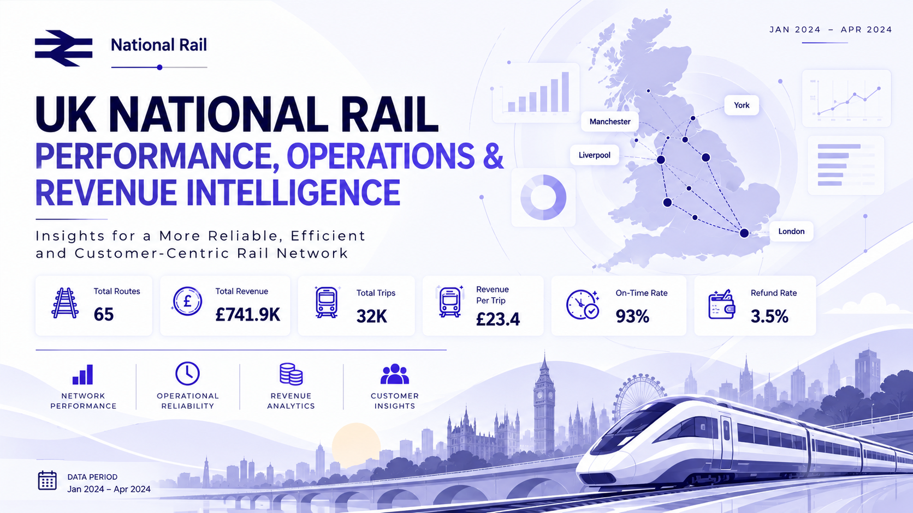
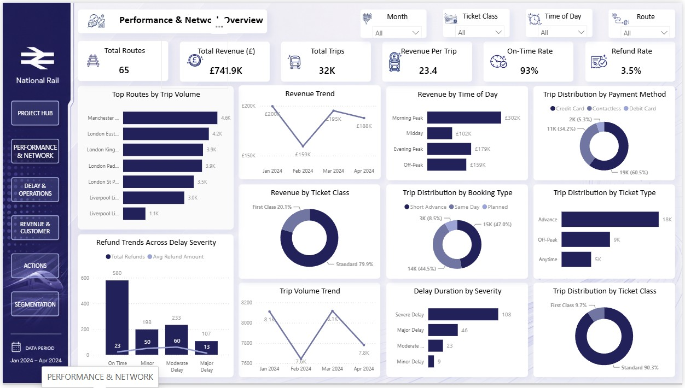
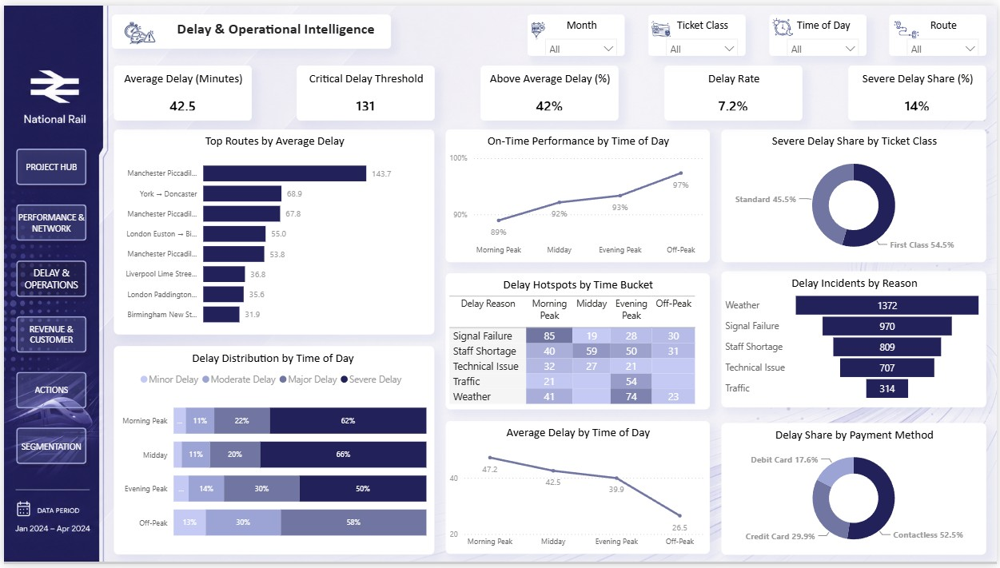
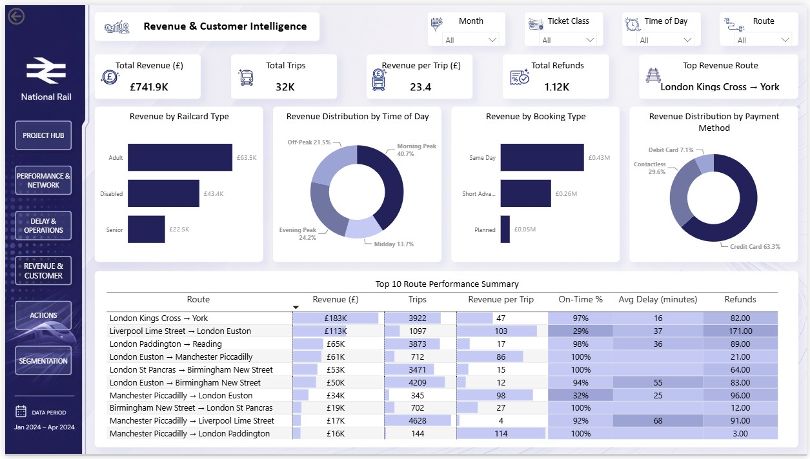

# UK National Rail Performance, Operations & Revenue Intelligence

> **How can railway operators protect revenue while improving reliability and customer experience?**

A Power BI case study examining **32K rail journeys across 65 routes** from **January–April 2024**, analysing network performance, delay behaviour, passenger booking patterns, customer-facing disruption and revenue performance through an integrated operational and commercial framework.



[**↗ Open the Live Power BI Dashboard**](https://app.powerbi.com/view?r=eyJrIjoiMjc3N2VhY2MtM2I0NC00YjY3LWIzNWUtOGFmYjM2MmZkMzIyIiwidCI6ImM2ZTU0OWIzLTVmNDUtNDAzMi1hYWU5LWQ0MjQ0ZGM1YjJjNCJ9&pageName=e6fcbf00b86c7e0c6000)

---

## ■ Why This Project?

Railway performance is not simply a question of whether trains arrive on time.

A useful railway performance analysis needs to establish **where demand and revenue are concentrated, where reliability deteriorates, what is driving delays, how disruption affects customers, and where operational intervention can protect commercial value**.

A high-revenue route with poor punctuality creates a different management problem from a low-value route with similar delay levels. Likewise, a period with strong passenger demand can create greater commercial exposure when reliability deteriorates.

That makes the important business question more specific than *“What is the on-time rate?”*

> **Where does operational risk intersect with customer impact and commercial value — and where should management intervene first?**

This project was built to answer that question through a structured **performance → diagnosis → commercial impact → action** framework rather than a collection of descriptive railway charts.

---

## ■ The Business Problem

The analysis focuses on six practical decisions:

1. **How is the network performing across routes, demand, revenue and reliability?**
2. **Where are delays concentrated by route, time period and severity?**
3. **What operational reasons are contributing most to disruption?**
4. **Which passenger, booking and ticket segments are most exposed to disruption?**
5. **Where does operational underperformance create the greatest commercial or refund risk?**
6. **Which routes, time periods and customer segments should receive management attention first?**

The objective is therefore not simply to report railway KPIs, but to move from:

```text
Performance Measurement
        ↓
Delay Diagnosis
        ↓
Customer & Booking Behaviour
        ↓
Revenue Impact
        ↓
Priority Identification
        ↓
Executive Action
```

---

## ■ Data at a Glance

The project is built around a journey-level railway dataset covering **January–April 2024**.

| Attribute | Value |
|---|---:|
| Total trips | **32K** |
| Total routes | **65** |
| Total revenue | **£741.9K** |
| Revenue per trip | **£23.4** |
| On-time rate | **93%** |
| Refund rate | **3.5%** |
| Average delay | **42.5 min** |
| Severe delay share | **14%** |
| Data period | **Jan 2024 – Apr 2024** |
| Customer/journey grain | **One record per journey** |

### Fields used across the analysis

The analytical model brings together journey timing, route, ticket and booking attributes, passenger/payment characteristics, delay information, refund status and revenue-related fields.

Key analytical dimensions include:

`Departure Station` · `Arrival Destination` · `Date of Purchase` · `Date of Journey` · `Journey Hour` · `Price` · `Ticket Class` · `Ticket Type` · `Booking Type` · `Payment Method` · `Railcard` · `Delay (Minutes)` · `Delay Status` · `Reason for Delay` · `Refund Request`

The project also creates analytical fields for **Route, Advance Booking Days, Journey Status, Booking Type, Time Bucket, Delay Severity and Refund Flag**.

---

## ■ Analytical Thinking

The project was structured around an operational-to-commercial chain:

```text
Network Performance
        +
Route & Time-of-Day Behaviour
        +
Delay Severity & Root Cause
        +
Passenger / Booking Behaviour
        ↓
Operational Risk
        ↓
Customer & Refund Impact
        ↓
Revenue Exposure
        ↓
Management Priority
        ↓
Business Action
```

Rather than treating revenue, punctuality, delays, ticket class and booking behaviour as isolated dimensions, the analysis examines how these signals combine to reveal different operational and commercial situations.

This becomes especially important when moving from **network-level performance to intervention priority**.

A route with high delay alone is not necessarily the first place to intervene.

The stronger question is:

> **Where does reliability risk intersect with passenger demand, revenue yield and customer impact?**

---

## ■ Analytical Framework

The report uses three primary analytical segmentation frameworks.

### 01 — Time Bucket Framework

Journey time was converted into operationally meaningful periods after examining the underlying distribution and validating the resulting groups against railway operating patterns.

| Segment | Definition |
|---|---|
| **Morning Peak** | 06:00–09:59 |
| **Midday** | 10:00–15:59 |
| **Evening Peak** | 16:00–19:59 |
| **Off-Peak** | Remaining hours |

The framework supports consistent comparisons of **demand, revenue, punctuality, delay and refund behaviour** across the day.

### 02 — Booking Type Framework

Advance purchase behaviour was transformed into three business-readable groups.

| Segment | Definition |
|---|---|
| **Same Day** | 0 days advance |
| **Short Advance** | 1–5 days |
| **Planned** | >5 days |

The objective is to distinguish different forms of passenger planning behaviour rather than treating advance-booking days as a purely continuous variable.

### 03 — Delay Severity Framework

Delay duration was translated into operational severity categories.

| Segment | Definition |
|---|---|
| **On Time** | 0 min |
| **Minor Delay** | 1–15 min |
| **Moderate Delay** | 16–30 min |
| **Major Delay** | 31–60 min |
| **Severe Delay** | >60 min |

This allows delay performance to be analysed not only through averages, but also through **severity and customer-impact concentration**.

### How the thresholds were developed

The thresholds were not selected as arbitrary visual bins.

The analytical framework followed:

```text
Observed Distribution
        ↓
Histogram Analysis
        ↓
Percentile / Statistical Evaluation
        ↓
Threshold Selection
        ↓
Business Rule Validation
        ↓
Operational Segment
```

The purpose was to create segments that were both **statistically informed and operationally interpretable**.

---

## ■ What the Analysis Found

### Morning Peak is the network's major commercial window

Morning Peak contributes approximately **40.7% of total revenue (£302K)**, while its on-time performance is weaker than the overall network baseline.

This creates an important operational-commercial tension:

> **The period generating the greatest revenue concentration also carries meaningful reliability exposure.**

Protecting Morning Peak performance therefore has a potentially larger commercial impact than applying the same operational effort uniformly across all periods.

---

### Liverpool–London combines commercial value with reliability risk

The **Liverpool Lime Street → London Euston** corridor demonstrates a high-yield but poor-reliability pattern.

The route combines strong revenue per trip with weak punctuality, making it a clear example of why route prioritisation should consider **both commercial value and operational performance**.

The decision is not simply to identify the worst-performing route.

It is to identify:

> **Which underperforming routes matter most economically?**

---

### Manchester–London shows a high-value reliability gap

The **Manchester Piccadilly → London Euston** corridor contains particularly valuable journeys, including high revenue per trip in First Class, while punctuality remains weak.

This creates a customer-experience and revenue-protection issue: premium-value journeys are being exposed to poor reliability.

The appropriate response is therefore not simply “improve punctuality”, but to investigate **where premium demand and reliability risk overlap**.

---

### Midday creates refund leakage

Midday contributes the lowest revenue among the major time buckets while showing a materially higher refund rate.

This suggests that refund exposure should not be evaluated only by absolute refund count.

A more useful question is:

> **Where is disruption creating disproportionate commercial leakage relative to the value generated by the period?**

---

### Severe delays concentrate at specific periods

Evening Peak records the highest severe-delay share, demonstrating why average delay alone is insufficient for operational decision-making.

A network can maintain a strong overall on-time rate while specific periods still experience concentrated severe disruption.

This supports the use of **delay severity alongside average delay and delay rate**.

---

### Kings Cross–York provides a benchmark

**London Kings Cross → York** emerges as the top revenue route while also demonstrating strong punctuality.

Rather than treating this only as a “top route” finding, the route can serve as a benchmark for understanding the characteristics of a commercially successful and operationally reliable corridor.

---

### February signals a yield problem

February shows a decline in revenue alongside lower trip volume and weaker revenue per trip.

The pattern suggests that the deterioration was not simply a demand-volume problem.

> **When both volume and yield decline, the commercial diagnosis needs to move beyond passenger counts.**

---

## ■ From Evidence to Decision

The findings translate into four broad operational roles:

```text
PROTECT
High-value + high-demand periods / corridors
        ↓
Protect revenue concentration while maintaining reliability

TURN AROUND
High-value + poor reliability
        ↓
Prioritize operational intervention where commercial exposure is high

RECOVER
High refund / disruption exposure
        ↓
Reduce customer-impact and commercial leakage

REPLICATE
High-value + reliable benchmark corridors
        ↓
Identify practices and operating characteristics worth scaling
```

The central decision principle is:

> **Prioritise operational intervention where reliability risk and commercial value intersect — not by delay rate alone.**

---

## ■ Technical Implementation

### Power Query & Data Preparation

The preparation layer was designed to create a consistent journey-level analytical foundation for operational, customer and revenue analysis.

The transformation process included:

- standardising source fields and data types
- preparing journey, route, timing, ticket and payment attributes
- creating analytical fields required for reporting
- constructing route-level identifiers
- calculating advance-booking behaviour
- deriving delay duration and operational severity
- preparing business-readable status fields for Power BI analysis

The transformation layer is intentionally focused on **analytical usability and business interpretation** rather than unnecessary preprocessing complexity.

### Data Model

The report is built around a journey-level analytical table containing the operational and commercial attributes required for the analysis.

The model supports the progression from:

```text
Journey
   ↓
Route / Time / Booking Behaviour
   ↓
Delay & Operational Performance
   ↓
Customer / Refund Impact
   ↓
Revenue & Yield
   ↓
Executive Decision
```

---

## ■ DAX & Analytical Logic

The project uses DAX measures and calculated columns selectively to convert the raw journey data into **business-facing KPIs, rankings and analytical segments**.

The README does not reproduce every measure in the model. The focus here is on DAX logic that demonstrates meaningful analytical reasoning and is used in the report.

### Dynamic Top Revenue Route

```DAX
Top Revenue Route =
VAR T =
    TOPN(
        1,
        ADDCOLUMNS(
            VALUES('railway'[Route]),
            "Revenue", [Total Revenue]
        ),
        [Revenue],
        DESC
    )
RETURN
MAXX(T, 'railway'[Route])
```

This dynamically identifies the highest-revenue route within the current filter context, allowing the KPI to respond to dashboard selections.

### Dynamic Top Delay Reason

```DAX
Top Delay Reason =
VAR T =
    TOPN(
        1,
        ADDCOLUMNS(
            VALUES('railway'[Reason for Delay]),
            "Trips", [Total Trips]
        ),
        [Trips],
        DESC
    )
VAR Result =
    MAXX(T, 'railway'[Reason for Delay])
RETURN
IF(
    ISBLANK(Result),
    "All Data",
    Result
)
```

This converts delay-reason ranking into a dynamic business-facing metric rather than a static label.

### Average Refund Amount

```DAX
Avg Refund Amount =
AVERAGEX(
    FILTER(
        'railway',
        'railway'[Refund Request] = "Yes"
    ),
    'railway'[Price]
)
```

This measure focuses the calculation specifically on refunded journeys, connecting refund activity with the value of the affected tickets.

### Severe Delay Share

```DAX
Severe Delay % (of Delays) =
DIVIDE(
    CALCULATE(
        COUNTROWS('railway'),
        'railway'[Delay Status] = "Severe Delay (>60 mins)"
    ),
    CALCULATE(
        COUNTROWS('railway'),
        'railway'[Delay Status] <> "On Time"
    )
)
```

The denominator is restricted to delayed journeys, making the metric a measure of **severity within the delayed population** rather than severe delays as a percentage of all journeys.

### Core Business KPIs

The report also uses business-facing measures including:

- Total Revenue
- Total Trips
- Total Routes
- Revenue per Trip
- On-Time %
- Refund Rate
- Average Delay
- Delay Rate
- Severe Delay Share
- Delayed Trips

The emphasis is on turning source fields into metrics that support **operational diagnosis and management decisions**.

---

## ■ Calculated Columns & Segmentation Logic

The project uses DAX calculated columns to convert raw journey attributes into reusable analytical dimensions.

### Advance Booking Days

```DAX
Advance Booking Days =
DATEDIFF(
    'railway'[Date of Purchase],
    'railway'[Date of Journey],
    DAY
)
```

### Booking Type

```DAX
Booking Type =
SWITCH(
    TRUE(),
    'railway'[Advance Booking Days] = 0, "Same Day",
    'railway'[Advance Booking Days] <= 5, "Short Advance",
    "Planned"
)
```

### Route

```DAX
Route =
'railway'[Departure Station] & " → " & 'railway'[Arrival Destination]
```

### Refund Flag

```DAX
Refund Flag =
IF(
    'railway'[Refund Request] = "Yes",
    1,
    0
)
```

### Journey Status

```DAX
Journey Status =
SWITCH(
    'railway'[On-Time % Flag],
    1, "On-Time",
    0, "Delayed",
    "Unknown"
)
```

### Delay Duration

```DAX
Delay (Minutes) =
DATEDIFF(
    'railway'[Arrival Time],
    'railway'[Actual Arrival Time],
    MINUTE
)
```

### Delay Status

```DAX
Delay Status =
SWITCH(
    TRUE(),
    'railway'[Delay (Minutes)] = 0, "On Time",
    'railway'[Delay (Minutes)] <= 15, "Minor Delay",
    'railway'[Delay (Minutes)] <= 30, "Moderate Delay",
    'railway'[Delay (Minutes)] <= 60, "Major Delay",
    "Severe Delay"
)
```

### Time Bucket

```DAX
Time Bucket =
SWITCH(
    TRUE(),
    'railway'[Journey Hour] >= 6 &&
        'railway'[Journey Hour] < 10, "Morning Peak",
    'railway'[Journey Hour] >= 10 &&
        'railway'[Journey Hour] < 16, "Midday",
    'railway'[Journey Hour] >= 16 &&
        'railway'[Journey Hour] < 20, "Evening Peak",
    "Off-Peak"
)
```

These calculated columns transform technical source fields into **business dimensions that can be consistently compared across performance, customer and revenue analysis**.

---

## ■ Report Architecture

The complete Power BI report is structured into six analytical views:

| Page | Purpose |
|---|---|
| **Project Hub** | Business context, objectives and analytical journey |
| **Performance & Network Overview** | Network demand, revenue, punctuality and portfolio baseline |
| **Delay & Operational Intelligence** | Delay patterns, severity, hotspots and operational causes |
| **Revenue & Customer Intelligence** | Customer behaviour, revenue, yield and route performance |
| **Executive Action Plan** | Evidence-backed strategic priorities |
| **Segmentation Framework & Business Definitions** | Methodology, thresholds and analytical definitions |

The presentation flow is deliberately structured as:

> **Context → Performance → Diagnosis → Commercial Impact → Action → Methodology**

The README keeps the visual presentation focused on the **three core analytical dashboard pages**, while the complete report pages are retained separately in the repository as reference material.

---

## ■ Executive Action Framework

The analysis translates into ten strategic priorities:

1. **Protect Morning Peak Revenue** — focus reliability improvement on the period generating the largest revenue concentration.
2. **Turn Around the Liverpool–London Corridor** — address the combination of high commercial value and weak punctuality.
3. **Recover Manchester–London High-Yield Value** — prioritise reliability where premium-value journeys are exposed.
4. **Reduce Midday Refund Leakage** — investigate the causes behind disproportionate refund exposure.
5. **Match Delay Actions to Root Causes** — align interventions with the operational reasons driving disruption.
6. **Close the First Class Reliability Gap** — protect premium customer experience where yield is higher.
7. **Prevent Delays from Becoming Severe** — intervene before moderate disruption develops into high-impact delay.
8. **Improve the Manchester–Liverpool Volume Corridor** — review operational performance on a high-volume corridor with weak commercial yield.
9. **Replicate the Kings Cross–York Success Model** — use a high-value, high-reliability route as a performance benchmark.
10. **Diagnose & Reverse February's Lost Yield** — investigate the combined decline in trips, revenue and revenue per trip.

These recommendations are **decision frameworks derived from the observed dataset**, not a production railway optimisation model.

---

## ■ Dashboard Preview

### Performance & Network Overview



Establishes the network baseline across route volume, revenue, revenue per trip, punctuality, ticket mix, booking behaviour and refund trends.

### Delay & Operational Intelligence



Moves from network-level performance into route hotspots, time-of-day reliability, delay severity and operational causes.

### Revenue & Customer Intelligence



Connects revenue, booking behaviour, railcards, payment methods and route-level commercial performance to customer and operational outcomes.

---

## ■ Project Deliverables

The repository is designed to preserve the analytical project alongside its supporting documentation:

```text
uk-national-rail-performance-operations-revenue-intelligence/
│
├── README.md
│
├── data/
│   └── railway.csv
│
├── images/
│   ├── 00_title_card.png
│   ├── 02_performance_network.jpg
│   ├── 03_delay_operational.jpg
│   └── 04_revenue_customer.jpg
│
├── docs/
│   ├── analytical_methodology.md
│   ├── data_dictionary.md
│   ├── dax_logic.md
│   ├── executive_recommendations.md
│   ├── report_architecture.md
│   └── segmentation_framework.md
│
├── powerbi/
│   ├── UK_National_Rail_Performance_Operations_Revenue_Intelligence.pbix
│   └── README.md
│
├── reference/
│   ├── README.md
│   └── project_pages/
│       ├── 01_project_hub.jpg
│       ├── 02_performance_network.jpg
│       ├── 03_delay_operational.jpg
│       ├── 04_revenue_customer.jpg
│       ├── 05_executive_action_plan.jpg
│       └── 06_segmentation_framework.jpg
│
└── Deliverables/
    ├── UK_National_Rail_Performance_Operations_Revenue_Intelligence.pdf
    └── Executive_Action_Plan.pdf
```

The `Deliverables/` folder contains the complete dashboard PDF and the separate executive action plan.

The `reference/` folder preserves the complete report-page sequence, while the README keeps the visual presentation focused on the three core analytical pages.

---

## ■ Tools & Skills

**Power BI** — interactive reporting, visual analytics and business storytelling  
**Power Query** — data preparation and analytical transformation  
**DAX** — KPI measures, ranking logic and business-specific analytical calculations  
**Statistical Segmentation** — distribution analysis, percentile evaluation and threshold design  
**Data Analysis** — operational, customer, booking and revenue analysis  
**Business Analytics** — prioritisation, commercial impact and executive decision support  
**Data Storytelling** — translating analytical evidence into stakeholder actions  
**Git & GitHub** — version control, documentation and portfolio publication

---

## ■ Author

**Debanjan Biswas**  
Data Analyst  Excel | SQL | Power BI | Python

**Email:** [bishwasdebanjan99@gmail.com](mailto:bishwasdebanjan99@gmail.com)  
**LinkedIn:** [linkedin.com/in/biswas-debanjan-2ab011148](https://www.linkedin.com/in/biswas-debanjan-2ab011148/)

---

## ■ Project Perspective

This project demonstrates an approach to operational analytics that starts with the **management decision**, not the visual.

The objective was to move through:

> **Business Problem → Analytical Framework → Evidence → Interpretation → Commercial Impact → Action → Communication**

The value of the project lies in deciding **which operational signals matter, how those signals should be structured, where commercial exposure is concentrated, and what the business should do with that evidence**.

A strong railway analytics project should therefore go beyond:

> *“The network has a 93% on-time rate.”*

It should answer:

> **Where is reliability failing? Why is it failing? Which passengers, routes and revenue streams are exposed? Where should management intervene first?**

That is the analytical role this project is designed to demonstrate.

> **Measure performance. Diagnose disruption. Quantify the commercial impact. Prioritise the intervention. Turn the evidence into action.**

---

<div align="center">

### Network Performance → Operational Reliability → Customer Impact → Revenue Protection → Executive Action

**Built with Power BI**

</div>
